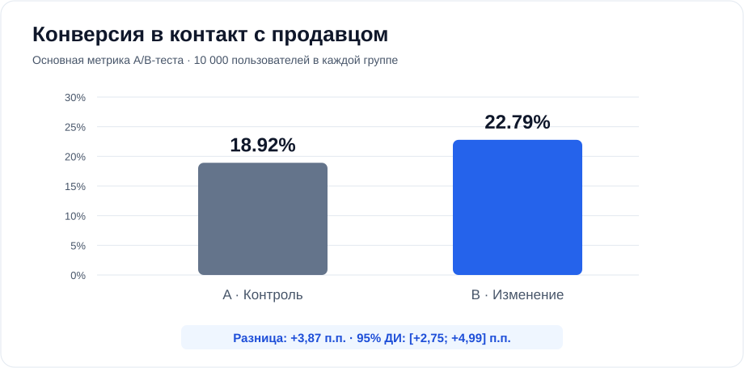
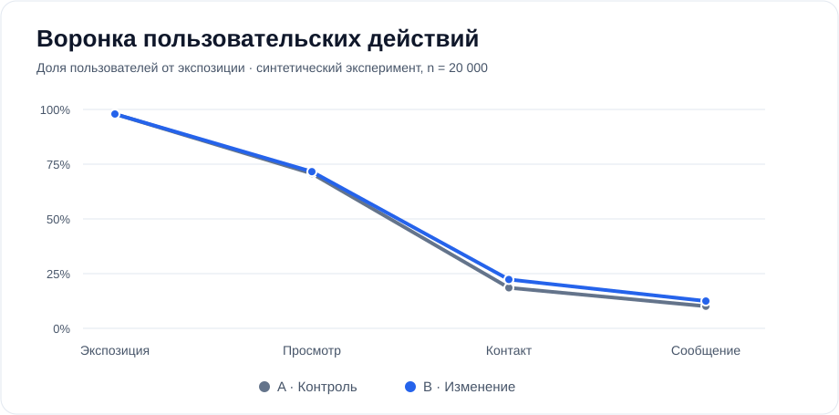

# Marketplace Product Analytics

**SQL · Python · A/B Testing · Product Funnel**

Учебный end-to-end кейс по продуктовой аналитике маркетплейса: от событийного лога и проверок качества данных до SQL-витрины, A/B-анализа и интерпретации результатов.

> **Данные полностью синтетические.** Это симуляция, а не аналитика реального маркетплейса. Изменение конверсии специально заложено в генератор, чтобы продемонстрировать методологию эксперимента.

## Продуктовая задача

Команда предполагает, что новый интерфейс карточки объявления увеличит вероятность обращения к продавцу. Нужно проверить корректность событий, построить воронку и оценить отличие между контрольной группой **A** и тестовой **B**.

**Воронка:** `exposure → listing_view → contact_click → message_sent`

- **Единица рандомизации:** пользователь, 50/50.
- **Основная метрика:** уникальные пользователи с `contact_click` / пользователи с `exposure`.
- **Вторичная метрика:** уникальные пользователи с `message_sent` / пользователи с `exposure`.
- **Защитные метрики:** доля пользователей с UI-ошибками и жалобами.

## Результаты симуляции (seed=2026)

| Метрика | Контроль A | Тест B |
|---|---:|---:|
| Пользователи | 10 000 | 10 000 |
| Конверсия в контакт | 18,92% | 22,79% |
| Конверсия в сообщение | 10,32% | 12,74% |

**Разница основной метрики:** +3,87 п.п. (относительно +20,45%). Двусторонний z-тест долей: `p ≈ 1,63×10⁻¹¹`; 95% доверительный интервал разницы: **[+2,75; +4,99] п.п.** Проверка SRM для равных групп не выявляет отклонения.





Подробный отчёт с проверками данных и ограничениями: [output/report.md](output/report.md).

## Техническая реализация

- **SQL (SQLite):** дедупликация по `event_id` с `ROW_NUMBER`, CTE, JOIN, построение витрины «один пользователь — одна строка», сегментация по категориям, анализ по дневным когортам.
- **Python:** воспроизводимая генерация событий, проверка входных данных, подсчёт метрик, z-тест для двух долей, 95%-й доверительный интервал и проверка SRM.
- **Matplotlib:** график воронки, сравнение групп и конверсия по дням.
- **unittest:** автоматическая проверка статистических функций, устранения дублей и логики воронки.

SQL написан для **SQLite**. Указанные конструкции близки к ANSI SQL, но исполнение в PostgreSQL отдельно не проверялось.

### Структура

```text
analysis.py             # генерация данных, запуск SQL, статистика, отчёт и визуализации
sql/01_clean.sql        # устранение дублей и невалидных событий
sql/02_mart.sql         # витрина пользовательской воронки
sql/03_ab_metrics.sql   # основные и защитные метрики
sql/04_segments.sql     # разрезы по категориям
sql/05_daily.sql        # когорты по дню назначения
sql/06_quality.sql      # контроль качества логирования
tests/test_analysis.py  # автоматические тесты
output/report.md        # пример итогового аналитического отчёта
output/*.svg            # визуализации
```

### Запуск

Требуется Python 3.10+.

```bash
python3 -m venv .venv
source .venv/bin/activate
pip install -r requirements.txt
python analysis.py
python -m unittest discover -s tests -v
```

На Windows активация виртуального окружения: `.venv\Scripts\activate`.

Скрипт автоматически создаёт `data/*.csv` (включая 20 000 пользователей и события), базу `output/analytics.sqlite`, промежуточные CSV, `output/result.json`, отчёт и графики. Сырые CSV и SQLite-файл не коммитятся: они воспроизводятся одной командой.

## Качество данных и ограничения

В логах специально присутствуют дубликаты `event_id`, неизвестные пользователи, события до назначения группы и сообщения без предыдущего контакта. Аналитическая витрина учитывает порядок событий и исключает некорректные логи. Воронка считается по **уникальным пользователям**, а не по числу событий.

Статистическая значимость в синтетическом сценарии **не является рекомендацией к реальному релизу**. Для реального A/B-теста понадобились бы предварительное планирование MDE и мощности, правила остановки, контроль стабильности логирования, интерпретация защитных метрик и учёт множественных сравнений при исследовании сегментов.