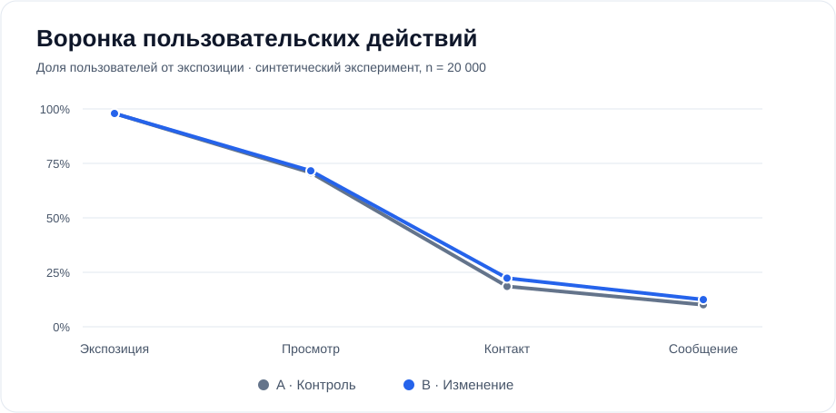
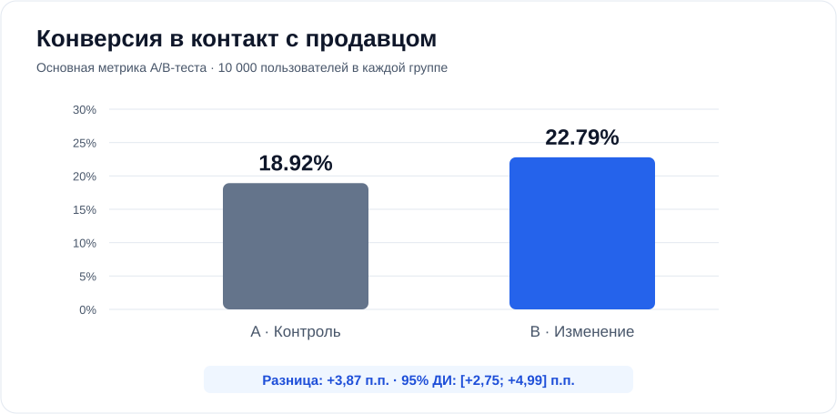
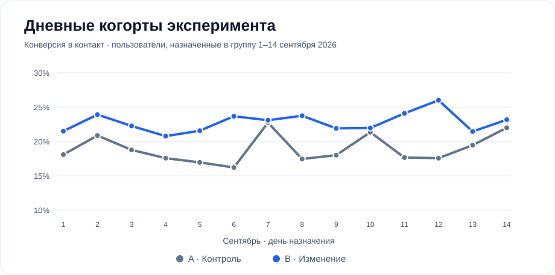

# Кейс: воронка маркетплейса и A/B-тест

> **Учебный проект на синтетических данных. Это НЕ результаты Avito.** Эффект B специально заложен в генератор.

## Гипотеза и метод
Изменённая карточка объявления (B) повысит долю пользователей, которые нажали «Связаться с продавцом».
Рандомизация по уникальному пользователю, 50/50. Деноминатор = все пользователи, получившие экспозицию.

**Основная метрика:** пользователи с `contact_click` / пользователи с `exposure`.
**Дополнительная метрика:** пользователи с `message_sent` / пользователи с `exposure`.
**Защитные метрики:** UI-ошибка и жалоба на пользователя.

## Проверка событий
- Сырых событий: **41,624**; пользователи: **20,000**.
- Дубли `event_id`: **100**.
- События от неизвестных пользователей: **10**.
- События до назначения группы: **8**.
- Сообщения без предыдущего контакта: **11**.

При расчёте исключены невалидные события; шаги воронки учитываются только по времени в верном порядке.

## Результаты
| Показатель | A | B |
|---|---:|---:|
| Экспонированные пользователи | 10,000 | 10,000 |
| Просмотр объявления | 7,222 | 7,311 |
| Контакт с продавцом | 1,892 | 2,279 |
| **Конверсия в контакт** | **18.92%** | **22.79%** |
| Конверсия в сообщение | 10.32% | 12.74% |
| UI-ошибки | 2.09% | 1.68% |
| Жалобы | 0.49% | 0.59% |

- Изменение конверсии B−A: **+3.87 п.п.**.
- Относительное изменение: **20.45%**.
- Двусторонний z-тест для двух долей: **p = 1.632e-11**.
- 95% доверительный интервал разницы: **[+2.75; +4.99] п.п.**.
- Проверка SRM (ожидаем 50/50): **p = 1**.
- P-value сообщений: 8.423e-08; ошибок: 0.03302; жалоб: 0.3346.

## Вывод
В симуляции разница по основной метрике статистически значима на уровне 5%.
Это **не основание** выкатывать изменение в реальном продукте: данные синтетические. Для настоящего эксперимента
нужны заранее зафиксированные длительность, MDE, мощность, стратегия остановки и анализ качества рандомизации.
Необнаружение изменений в защитных метриках **не доказывает** их безопасности.
Сегментация по категориям исследовательская, без заявлений о значимости множественных проверок.

## Визуализация

